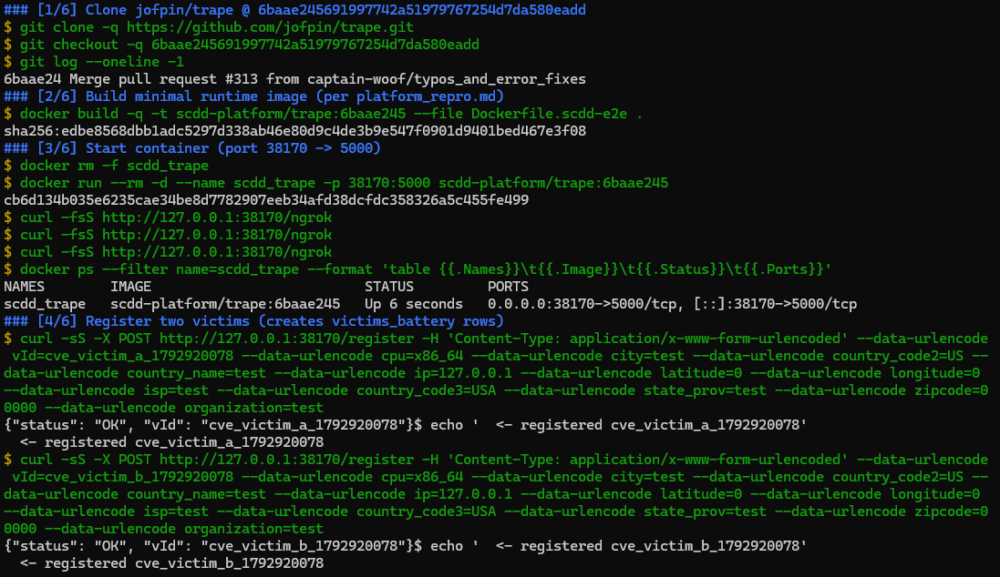
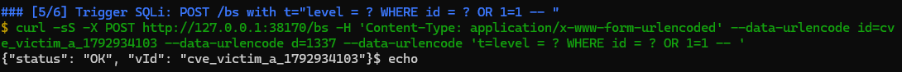
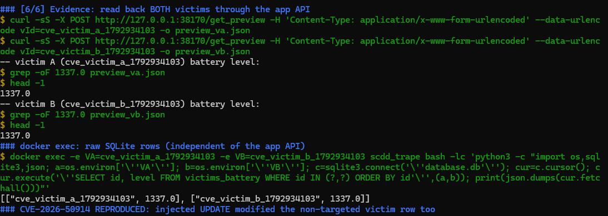

[CVE ID]

CVE-2026-50914

[PRODUCT]

Trape (jofpin/trape)

[VERSION]

master @ commit 6baae245691997742a51979767254d7da580eadd

[PROBLEM TYPE]

SQL Injection (CWE-89)

# Description

The battery-status endpoint `POST /bs` in [trape master branch](https://github.com/jofpin/trape/blob/6baae245691997742a51979767254d7da580eadd/core/user.py#L143-L145) takes the form field `t` (battery attribute name) and passes it unvalidated into the SQL layer. The statement in [core/db.py L140-L141](https://github.com/jofpin/trape/blob/6baae245691997742a51979767254d7da580eadd/core/db.py#L140-L141) is built by string concatenation:

```python
"UPDATE victims_battery SET " + data[2] + " = ? WHERE id = ?"
```

so `t` becomes part of the SQL syntax itself. An unauthenticated attacker can inject an arbitrary `WHERE` predicate (e.g. `OR 1=1`), turning a per-victim battery update into an update of every tracked victim's row.

# Proof of Concept

## victim setup

run trape on localhost:38170 (no official Docker setup; minimal image built from the pinned commit: `docker run -d -p 38170:5000 trape@6baae245`), then register two victims `victim_a` / `victim_b` through the normal `POST /register` flow — both start with battery level 100.



## attack steps

POST 127.0.0.1:38170/bs with `id=victim_a&d=1337&t=level = ? WHERE id = ? OR 1=1 -- ` — the injected `t` rewrites the UPDATE into `SET level = ? WHERE id = ? OR 1=1 -- ...`, so both victims' rows are updated although only `victim_a` was addressed.



reading both victims back through the app API (`POST /get_preview`) and a direct in-container SQLite dump show `level = 1337.0` for **both** victims:

```json
[["cve_victim_a_...", 1337.0], ["cve_victim_b_...", 1337.0]]
```



# Impact

An unauthenticated attacker who can reach the trape panel can modify rows belonging to arbitrary tracked victims in `victims_battery` (demonstrated: cross-victim overwrite of `level`) and corrupt the integrity of collected OSINT data. No authentication is required; network reachability of the panel is the only precondition.

# Occurrences

core/db.py L140-L141
