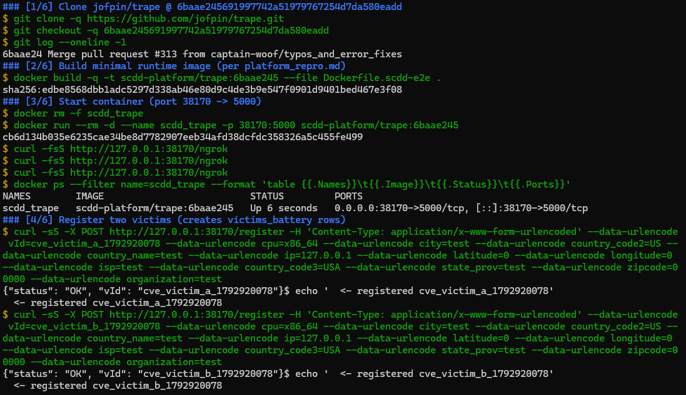
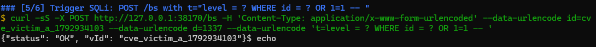
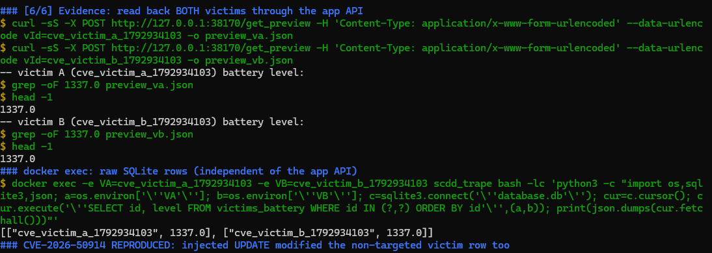

[CVE ID]

CVE-2026-50914

[PRODUCT]

Trape (jofpin/trape)

[VERSION]

master @ commit 6baae245691997742a51979767254d7da580eadd

[PROBLEM TYPE]

SQL Injection (CWE-89)

# Description

The battery-status endpoint [`POST /bs` in the trape master branch](https://github.com/jofpin/trape/blob/6baae245691997742a51979767254d7da580eadd/core/user.py#L143-L145) takes the form field `t` representing the battery attribute name and passes it directly into the SQL query without validation. The statement in [`core/db.py` on lines 140-141](https://github.com/jofpin/trape/blob/6baae245691997742a51979767254d7da580eadd/core/db.py#L140-L141) is constructed using string concatenation:

```python
"UPDATE victims_battery SET " + data[2] + " = ? WHERE id = ?"
```

Consequently, `t` becomes part of the SQL syntax. An unauthenticated attacker can inject an arbitrary `WHERE` predicate, such as `OR 1=1`, which changes a per-victim battery update into an update affecting every victim's row.

# Proof of Concept

## victim setup

Run trape on localhost:38170 using a minimal image built from the pinned commit: `docker run -d -p 38170:5000 trape@6baae245`. Register two victims, `victim_a` and `victim_b`, through the standard [`POST /register`](https://github.com/jofpin/trape/blob/6baae245691997742a51979767254d7da580eadd/core/user.py#L72) flow. Both start with a battery level of 100.



## attack steps

1. Send a `POST` request to `127.0.0.1:38170/bs` with the body `id=victim_a&d=1337&t=level = ? WHERE id = ? OR 1=1 -- `. The injected `t` field modifies the UPDATE statement to `SET level = ? WHERE id = ? OR 1=1 -- ...`. As a result, both victims' rows are updated even though only `victim_a` was specified:

	```bash
	curl -sS -X POST http://127.0.0.1:38170/bs -d 'id=victim_a&d=1337&t=level = ? WHERE id = ? OR 1=1 -- '
	```

	

2. Retrieve both victims via the application API ([`POST /get_preview`](https://github.com/jofpin/trape/blob/6baae245691997742a51979767254d7da580eadd/core/stats.py#L83)) and a direct SQLite dump from the container. The battery level is 1337.0 for both victims:

	```json
	[["cve_victim_a_...", 1337.0], ["cve_victim_b_...", 1337.0]]
	```

	

# Impact

By abusing the `t` field, an unauthenticated attacker who can reach the trape panel can alter rows belonging to arbitrary tracked victims in `victims_battery`:

- Cross-victim overwrite: one request updates every victim's row instead of the named victim only (demonstrated: `level` set to 1337.0 for both victims).
- No authentication is required; network reachability of the panel is the only precondition.
- Corrupts the integrity of collected OSINT data.

# Occurrences

- [`core/user.py L143-L145`](https://github.com/jofpin/trape/blob/6baae245691997742a51979767254d7da580eadd/core/user.py#L143-L145) — `POST /bs` handler, form field `t` forwarded unsanitized
- [`core/db.py L140-L141`](https://github.com/jofpin/trape/blob/6baae245691997742a51979767254d7da580eadd/core/db.py#L140-L141) — sink, UPDATE statement assembled by string concatenation

# Remediation

Recommended fixes:

- Build the UPDATE clause from an allowlist of battery column names instead of concatenating the client-supplied `t` value.
- Reject any `t` value that is not an exact match for a known column identifier before it reaches the query builder.
