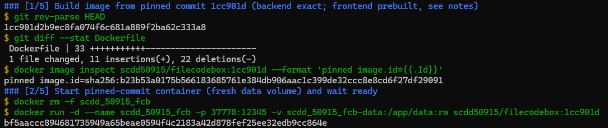
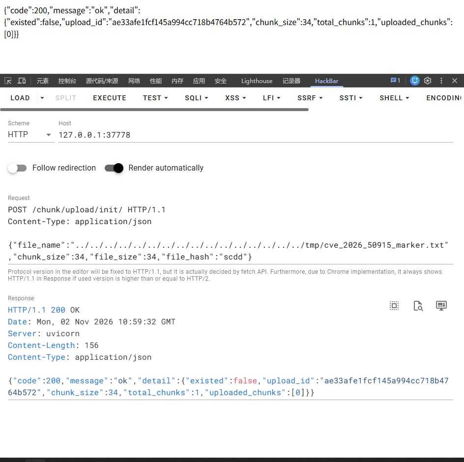
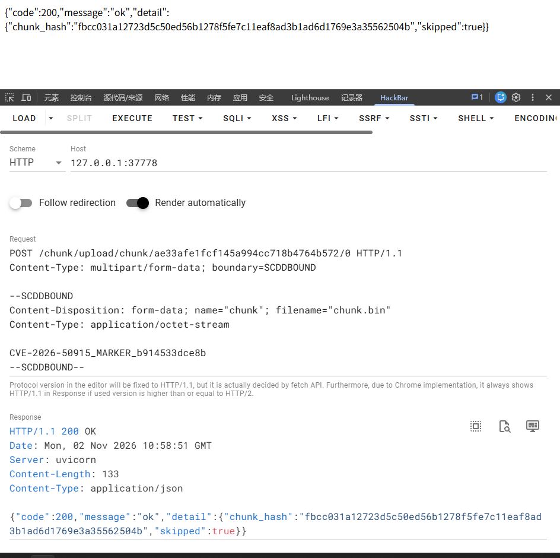
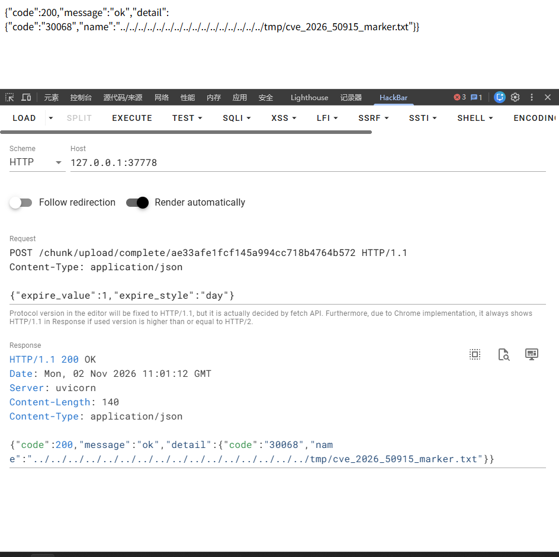

[CVE ID]

CVE-2026-50915

[PRODUCT]

FileCodeBox (vastsa/FileCodeBox)

[VERSION]

commit 1cc901d2b9ec8fa074f6c681a889f2ba62c333a8 (pre-v2.7.1; v2.7.1 adds `sanitize_filename` on this input)

[PROBLEM TYPE]

Path Traversal leading to Arbitrary File Write (CWE-22)

# Description

The chunked-upload API accepts a `file_name` parameter from `POST /chunk/upload/init/` that is controlled by the attacker and passes it into the storage path without sanitization. The function [`get_chunk_file_path_name()`](https://github.com/vastsa/FileCodeBox/blob/1cc901d2b9ec8fa074f6c681a889f2ba62c333a8/apps/base/utils.py#L34-L42) in `apps/base/utils.py` splits the name into a prefix and suffix and returns a path defined as `save_path = f"{path}/{prefix}{suffix}"`. During the merge process, [`merge_chunks()`](https://github.com/vastsa/FileCodeBox/blob/1cc901d2b9ec8fa074f6c681a889f2ba62c333a8/core/storage.py#L198-L199) in `core/storage.py` appends this relative path to the storage root:

```python
output_path = self.root_path / save_path
output_path.parent.mkdir(parents=True, exist_ok=True)
```

The `pathlib` library does not neutralize `..` segments. Therefore, a `file_name` containing multiple `../` sequences can escape the `/app/data` storage root, allowing an attacker to write files to arbitrary paths. The required depth equals the number of directory components under the storage root; eight `../` sequences cancel the default Docker layout (`app/data/share/data/<date>/<upload_id>`), sixteen leaves margin for deeper storage paths, and excess `../` sequences past the filesystem root are harmless. Authentication is not required, as the chunk endpoints sit behind [`share_required_login()`](https://github.com/vastsa/FileCodeBox/blob/1cc901d2b9ec8fa074f6c681a889f2ba62c333a8/apps/admin/dependencies.py#L102), which only enforces a token if `openUpload` is set to 0. By default, the application runs with `openUpload=1`. Upstream version 2.7.1 added `sanitize_filename()` using `os.path.basename` to this input, which is why the pinned commit is used for reproduction.

# Proof of Concept

## victim setup

Build the image from the pinned commit (backend exact, frontend prebuilt) and start the container with a fresh data volume on port 37778. The home page should respond with a 200 OK status.



## attack steps

The attack consists of three unauthenticated requests, all without an `Authorization` header:

1. `POST /chunk/upload/init/` with `file_name` set to `../../../../../../../../../../../../../../../../tmp/cve_2026_50915_marker.txt`, which returns an `upload_id`:

	

2. `POST /chunk/upload/chunk/{upload_id}/0` which uploads a 34-byte marker as a multipart part:

	

3. `POST /chunk/upload/complete/{upload_id}` which merges the chunks into the traversed path. The response is a 200 OK status, and `detail.name` echoes the attacker-controlled traversal path. This confirms the server merged the upload outside the intended storage root:

	```json
	{"code":200,"message":"ok","detail":{"code":"30068","name":"../../../../../../../../../../../../../../../../tmp/cve_2026_50915_marker.txt"}}
	```

	

4. Verify inside the victim container. The merged file exists at exactly that path with the uploaded marker as its content, and no copy exists under `/app/data`:

	```console
	$ ls -la /tmp/cve_2026_50915_marker.txt
	-rw-r--r-- 1 root root 34 Sep 28 13:07 /tmp/cve_2026_50915_marker.txt
	$ cat /tmp/cve_2026_50915_marker.txt
	CVE-2026-50915_MARKER_b914533dce8b
	$ find /app/data -name 'cve_2026_50915_marker.txt'
	(no results)
	```

# Impact

By declaring a traversal `file_name` in the chunk-init request, an unauthenticated attacker who can reach the service can write fully attacker-controlled content to an arbitrary path writable by the FileCodeBox service account:

- Arbitrary file write (demonstrated: marker written to `/tmp`, outside `/app/data`); the service account is root in the official image.
- Direct RCE was not demonstrated in this PoC, but overwriting service-reachable files (application code, packages imported on restart) is a plausible escalation path consistent with the CVE description.
- Current v2.7.1 sanitizes `file_name` via `os.path.basename` and is not affected.

# Occurrences

- [`apps/base/utils.py L34-L42`](https://github.com/vastsa/FileCodeBox/blob/1cc901d2b9ec8fa074f6c681a889f2ba62c333a8/apps/base/utils.py#L34-L42) — `get_chunk_file_path_name()`, raw `file_name` embedded into `save_path`
- [`core/storage.py L198-L199`](https://github.com/vastsa/FileCodeBox/blob/1cc901d2b9ec8fa074f6c681a889f2ba62c333a8/core/storage.py#L198-L199) — `merge_chunks()` sink, `root_path / save_path` join and write

# Remediation

Recommended fixes:

- Reduce `file_name` to its base name (`os.path.basename`, as v2.7.1 does) and reject any residual path separators before joining.
- Resolve the final save path and verify it stays inside the storage root before merging.
